<div align="center">

**Universidad de San Carlos de Guatemala**  
**Facultad de Ingenieria**  
**Sistemas Operativos 1 - P**  
**Nombre: Daniel Estuardo Salvatierra Macajola**   
**Carnet: 202202768**  
**Guatemala 17 de Febrero 2026**  

</div>

<h1 align="center">Proyecto 1 - Guia de instalación</h1>

## Tabla de contenido
1. [Requisitos del Sistema](#1-requisitos)
2. [Instalacion del Entorno de Virtualizacion](#2-instalación-del-entorno-virtualizado-kvm)
3. [Creacion de las Maquinas Virtuales](#3-creacion-de-las-maquinas-virtuales)
4. [Configuracion de VM1 y VM2 para Containerd](#4-configuración-de-vm1-y-vm2-para-containerd)
5. [Configuracion de VM3 con Docker y Zot](#5-configuración-de-vm3-con-docker-y-zot)
6. [Zot y Subida de Imágenes](#6-zot-y-subida-de-imágenes)
7. [Pasar contenedores a VM1 y VM2 desde Zot](#7-pasar-contenedores-a-vm1-y-vm2-desde-zot)
8. [Verificar que las APIs se comunican correctamente entre sí](#8-verificar-que-las-apis-se-comunican-correctamente-entre-sí)

## 1. Requisitos del Sistema y Entorno
Para la correcta ejecución y despliegue del proyecto, se deben cumplir con los siguientes requisitos de hardware, software e infraestructura:

- Sistema operativo base: Ubuntu 22.04 LTS o cualquier distribucion Linux.
- CPU con soporte para virtualización (Intel VT-x o AMD-V) habilitado obligatoriamente desde la BIOS.
- Se recomienda un mínimo de 8 GB para distribuir eficientemente entre el Host y las 3 VMs.
- Espacio suficiente para alojar tres discos virtuales de máquinas virtuales y el almacenamiento de imágenes del registro Zot (Almenos 50 GB).
- Procesador basado en x86_64 para compatibilidad con las imágenes de contenedores compiladas.
- Acceso a Internet
- Permisos sudo

Verificar soporte de virtualización:
```bash
egrep -c '(vmx|svm)' /proc/cpuinfo
```
Si el resultado es mayor que 0, el equipo soporta virtualización.

## 2. Instalación del Entorno Virtualizado (KVM)

### 2.1 Instalar KVM y dependencias
```bash
sudo apt update
sudo apt install -y qemu-kvm libvirt-daemon-system libvirt-clients bridge-utils virt-manager
```
Describe cada paquete:
- `qemu-kvm`: El hipervisor que permite la virtualización.
- `libvirt-daemon-system`: Proporciona el servicio de gestión de máquinas virtuales.
- `libvirt-clients`: Herramientas de línea de comandos para interactuar con libvirt.
- `bridge-utils`: Utilidades para configurar puentes de red, necesarios para la conectividad de las máquinas virtuales.
- `virt-manager`: Interfaz gráfica para gestionar máquinas virtuales
### 2.2 Verificar la instalación
```bash
sudo systemctl status libvirtd
```
Debería mostrar que el servicio está activo y corriendo sino ejecutar el punto 2.4 para iniciar el servicio.
```bash
virsh list --all
```
Este comando debería mostrar una lista vacía de máquinas virtuales, indicando que KVM está listo para crear y gestionar VMs.

### 2.3 Agregar el usuario al grupo libvirt
```bash
sudo usermod -aG libvirt $USER
sudo usermod -aG kvm $USER
```
Después de ejecutar este comando, es necesario cerrar sesión y volver a iniciarla para que los cambios surtan efecto.

### 2.4 Iniciar y habilitar el servicio de libvirt
```bash
sudo systemctl start libvirtd
sudo systemctl enable --now libvirtd
```
Esto asegura que el servicio de libvirt se inicie automáticamente al arrancar el sistema y esté activo para gestionar las máquinas virtuales.

## 3. Creación de las Máquinas Virtuales

Para crear las máquinas virtuales, se utilizará `virt-manager` o `virsh` desde la terminal. Se recomienda usar `virt-manager` para una experiencia más visual y sencilla. Se recomienda una iso con pocos requisitos para tener una expriencia fluida, como por ejemplo Ubuntu Server 22.04 LTS que es la que se utilizo en este proyecto.

Se deben crear tres máquinas virtuales:

|VM |    Proposito     |   Runtime  |
|---|------------------|------------|
|VM1|   API1 y API2    | Containerd |
|VM2|       API3       | Containerd |
|VM3| Registro Privado | Containerd |

### 3.1 Crear una máquina virtual con virt-manager
1. Abrir `virt-manager`.
2. Hacer clic en "Nuevo" para crear una nueva VM.
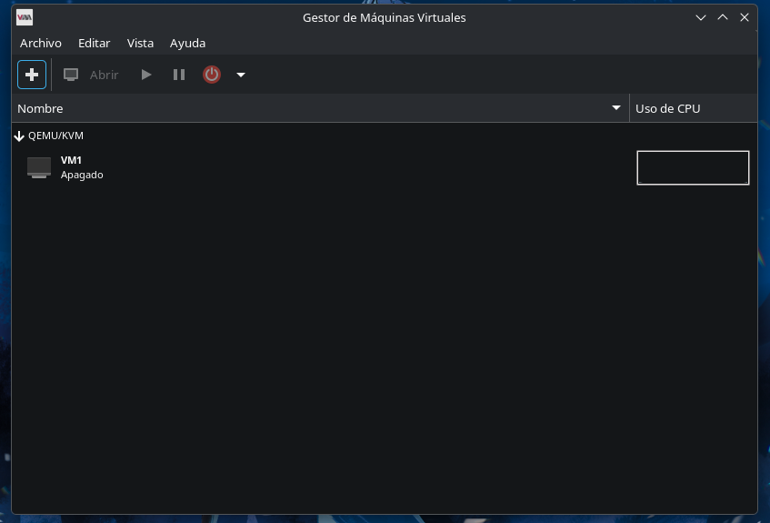
3. Seleccionar "Instalación desde un archivo de imagen ISO".
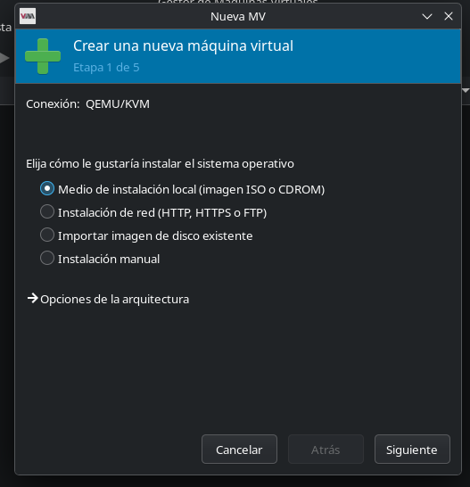
4. Cargar el archivo ISO de Ubuntu Server 22.04 LTS.
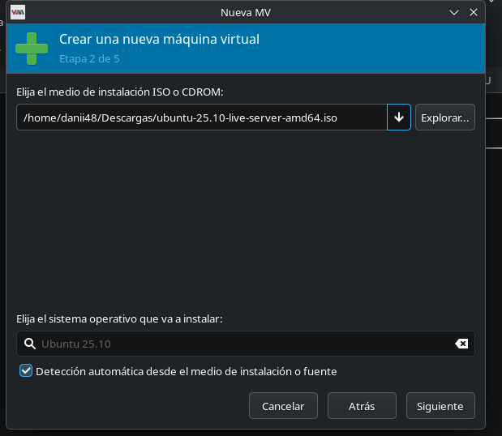
5. Configurar la VM con al menos 2GB de RAM, 2 CPUs y 10GB de disco duro.
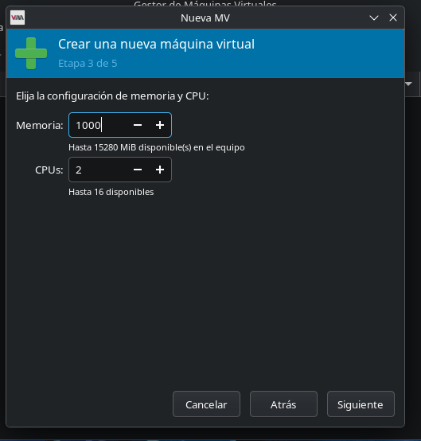 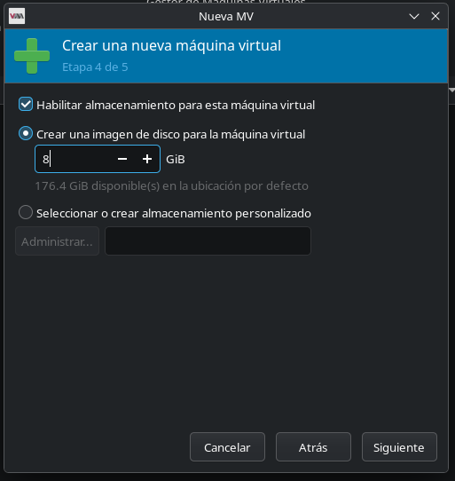
6. Asignar nombre y verificar las configuraciones.
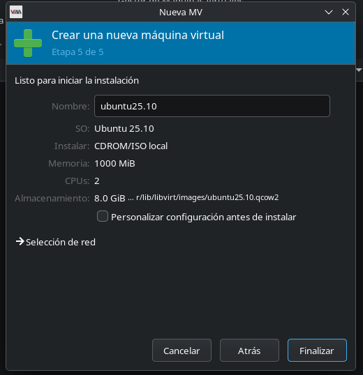
7. Repetir el proceso para crear las tres máquinas virtuales necesarias para el proyecto.
8. Finalizar la instalación del sistema operativo dentro de la VM.

### 3.2 Crear máquinas virtuales desde la terminal con virsh
```bash
virt-install \
--name vm1 \  # Nombre de la máquina virtual
--ram 2048 \  # Memoria RAM asignada (2GB)
--vcpus 2 \  # Número de CPUs asignados
--disk path=/var/lib/libvirt/images/vm1.qcow2,size=10 \  # Disco duro de 10GB
--os-variant ubuntu22.04 \  # Tipo de sistema operativo
--graphics none \  # Sin interfaz gráfica
--console pty,target_type=serial \  # Consola serial para la instalación
--location /path/to/ubuntu-22.04-server-amd64.iso  # Ruta al archivo ISO de instalación
```
Repetir este comando para cada máquina virtual, cambiando el nombre y la ruta del disco según corresponda (vm2.qcow2, vm3.qcow2, etc.).

### 3.3 Instalacion del sistema operativo dentro de las VMs
1. Al presionar finalizar la creación de cada VM, se iniciará el proceso de instalación del sistema operativo.
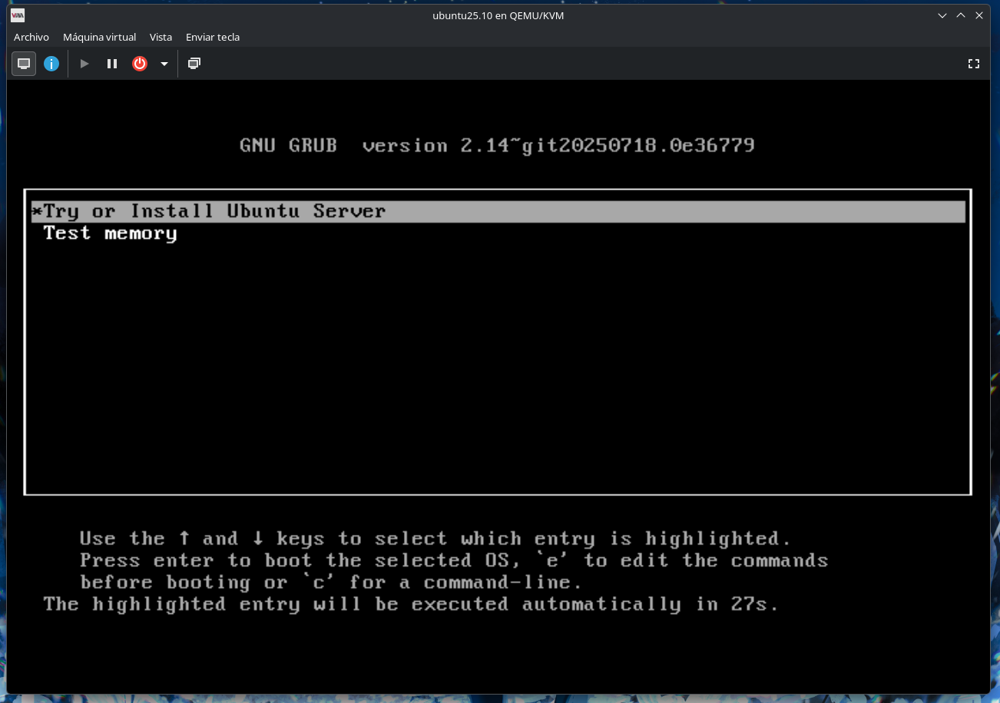
2. Primero seleccionar idioma y configuración regional.
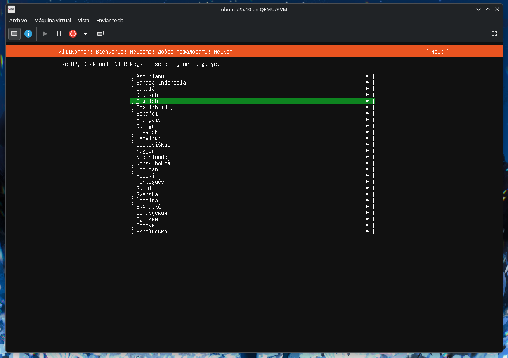
3. Seleccionar configuración de teclado.
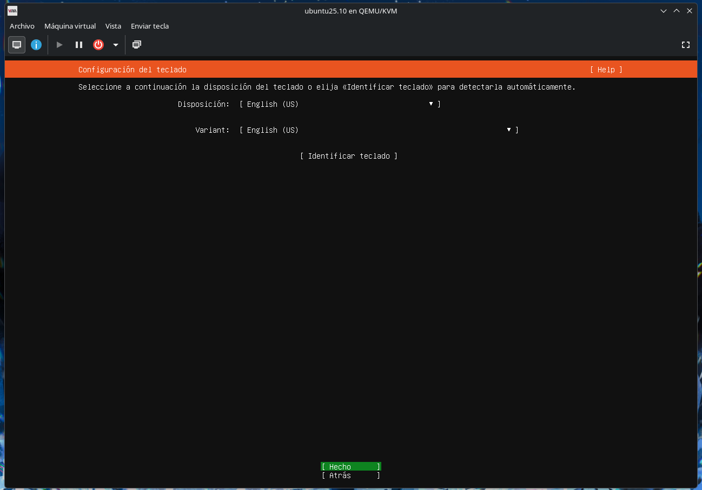
4. Seleccionar Ubuntu Server
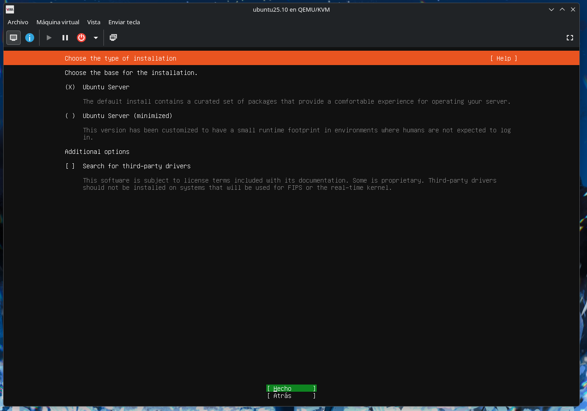
5. Deberia aparecer asignarse automaticamente DHCP4, si no es asi verificar que enp1s0 este configurada para obtener IP automaticamente, seleccionando enp1s0 y habilitar la opcion.
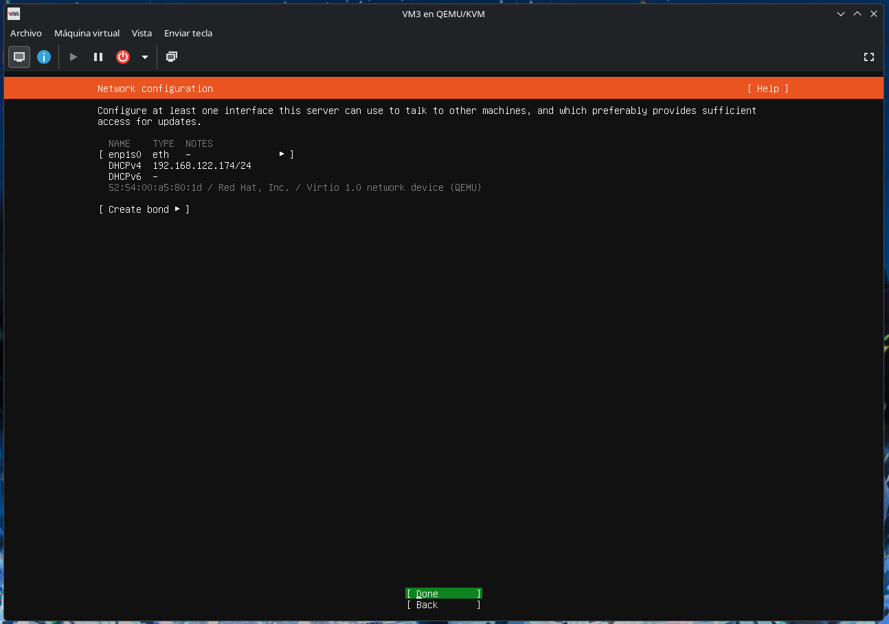
6. Proxy dejar en blanco y continuar.
7. En mirror addresses esperar que termine de cargar y seleccionar siguiente.
8. En la siguiente seccion seleccionar siguiente 2 veces y dejar la distribucion del disco por defecto.
9. Configurar el usuario administrador y contraseña.
10. Seleccionar instalacion de OpenSSH Server para poder acceder a las VMs por SSH.
11. Dar siguiente y esperar a que termine la instalacion del sistema operativo.
12. Repetir el proceso para cada una de las máquinas virtuales.
13. Una vez finalizada la instalación, iniciar sesión en cada VM y guardar la dirección IP asignada por DHCP para cada una de las VMs, ya que se necesitará para configurar la red y acceder a ellas posteriormente.
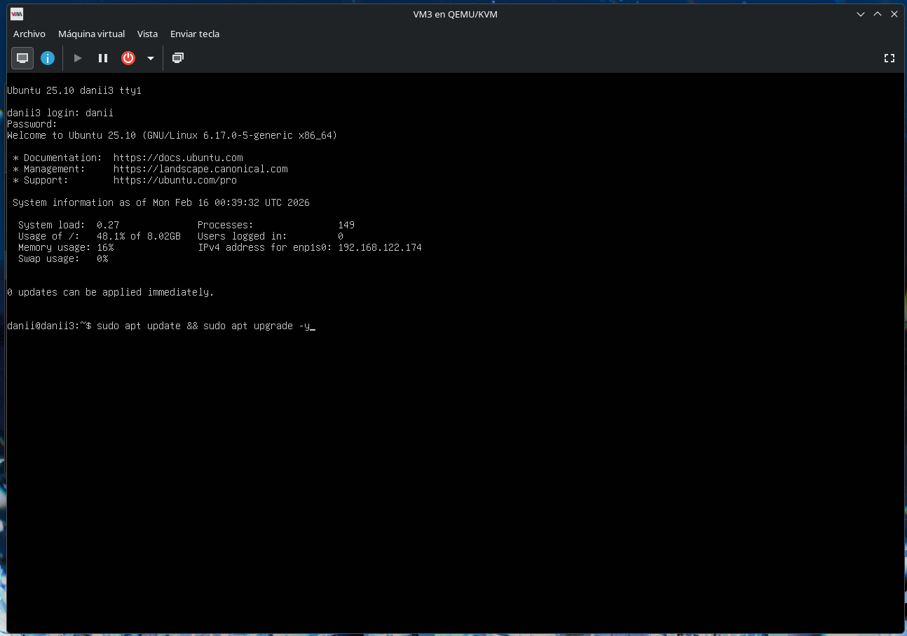
14. Otra manera de obtener la IP de cada VM es:
```bash
ip addr 
```
### 3.4 Verificar conectividad entre las VMs y el Host
1. Desde el Host, intentar hacer ping a cada una de las VMs utilizando sus direcciones IP para verificar que hay conectividad de red.
```bash
ping 192.168.122.90
ping 192.168.122.79
ping 192.168.122.109

# Tambien se puede usar SSH para verificar la conectividad y acceder a las VMs
ssh danni1@192.168.122.90
ssh <usuario>@<IP_VM2>
ssh <usuario>@<IP_VM3>
```

## 4. Configuración de VM1 y VM2 para Containerd
Iniciar sesión en VM1 y VM2, realizar el proceso de configuración utilizando SSH o la consola de virt-manager.
### 4.1 Conectar por SSH a VM1
```bash
ssh danni1@192.168.122.90
```
### 4.2 Actualizar el sistema operativo
```bash
sudo apt update && sudo apt upgrade -y
```
### 4.3 Instalar Containerd
```bash
sudo apt install -y containerd
```
### 4.4 Configurar Containerd para usar el runtime runc
```bash
sudo mkdir -p /etc/containerd
sudo containerd config default | sudo tee /etc/containerd/config.toml
sudo sed -i 's/SystemdCgroup = false/SystemdCgroup = true/g'  /etc/containerd/config.toml
sudo systemctl restart containerd
```
### 4.5 Iniciar el servicio de containerd
```bash
sudo systemctl start containerd
sudo systemctl enable containerd

## Veificar estado del servicio
sudo systemctl status containerd
```

### 4.6 Inslar Runc
```bash
sudo apt install -y runc
```
### 4.7 Instalar Nerdctl
```bash
# Version
NERDCTL_VERSION="1.7.3"

# Descargar nerdctl
wget
https://github.com/containerd/nerdctl/releases/download/v${NERDCTL_VERSION}/nerdctl-${NERDCTL_VERSION}-linux-amd64.tar.gz

# Extraer el archivo tar.gz
tar -xzf nerdctl-${NERDCTL_VERSION}-linux-amd64.tar.gz

# Limpiar el archivo descargado
rm nerdctl-${NERDCTL_VERSION}-linux-amd64.tar.gz

# Verificar que nerdctl se ha instalado correctamente
nerdctl --version
```

### 4.8 Instalar CNI Plugins
```bash
# Version
CNI_PLUGINS_VERSION="1.4.0"

# Crear directorio para los plugins CNI
sudo mkdir -p /opt/cni/bin

# Descargar los plugins CNI
wget
https://github.com/containernetworking/plugins/releases/download/v${CNI_VERSION}/cni-plugins-linux-amd64-v${CNI_VERSION}.tgz

# Extraer el archivo tar.gz en el directorio de plugins CNI
sudo tar -xzf cni-plugins-linux-amd64-v${CNI_PLUGINS_VERSION}.tgz -C /opt/cni/bin

# Limpiar el archivo descargado
rm cni-plugins-linux-amd64-v${CNI_PLUGINS_VERSION}.tg

# Verificar que los plugins CNI se han instalado correctamente
ls /opt/cni/bin
```

### 4.9 Configurar red de Containerd para usar CNI
```bash
# Crear el directorio de configuración de CNI
sudo mkdir -p /etc/cni/net.d

# Crear un archivo de configuración de red CNI para Containerd
cat > /etc/cni/net.d/10-containerd-net.conflist <<EOF
{
  "cniVersion": "1.0.0",
  "name": "containerd-net",
  "plugins": [
    {
      "type": "bridge",
      "bridge": "cni0",
      "isGateway": true,
      "ipMasq": true,
      "promiscMode": true,
      "ipam": {
        "type": "host-local",
        "ranges": [
          [{
            "subnet": "10.88.0.0/16"
          }]
        ],
        "routes": [
          { "dst": "0.0.0.0/0" }
        ]
      }
    },
    {
      "type": "portmap",
      "capabilities": {"portMappings": true}
    }
  ]
}
EOF
```

### 4.10 Verificar instalación
```bash
# Verificar versiones
containerd --version
nerdctl --version
runc --version

# Listar contenedores (debe estar vacío)
nerdctl ps

# Probar funcionamiento
nerdctl run --rm alpine echo "Containerd funcionando correctamente"
```

### 4.11 Repetir el proceso en VM2
Repetir los pasos del 4.1 al 4.10 en VM2 para configurar Containerd también en esa máquina virtual, asegurando que ambas VMs estén listas para ejecutar contenedores utilizando Containerd.
``` bash
# para salir de la sesión SSH
exit

# conectar a VM2
ssh <usuario>@<IP_VM2>
# repetir los pasos de configuración en VM2
``` 

## 5. Configuración de VM3 con Docker y Zot
Iniciar sesión en VM3, realizar el proceso de configuración utilizando SSH o la consola de virt-manager.
### 5.1 Conectar por SSH a VM3
```bash
ssh danni3@192.168.122.109
```

### 5.2 Actualizar el sistema operativo
```bash
sudo apt update && sudo apt upgrade -y
```
### 5.3 Instalar Dependencias para Docker
```bash
sudo apt install -y apt-transport-https ca-certificates curl gnupg lsb-release
```

### 5.4 Instalar repositorio Docker
```bash
    # Directorio para keys
    sudo mkdir -p /etc/apt/keyrings

    # Descarga de KEY GPG de Docker
    curl -fsSL https://download.docker.com/linux/ubuntu/gpg | sudo gpg --dearmor -o /etc/apt/keyrings/docker.gpg

    # Agregar repositorio de Docker a las fuentes de APT
    echo \
    "deb [arch=$(dpkg --print-architecture) signed-by=/etc/apt/keyrings/docker.gpg] https://download.docker.com/linux/ubuntu \
    $(lsb_release -cs) stable" | tee /etc/apt/sources.list.d/docker.list > /dev/null

    # Actualizar la lista de paquetes
    sudo apt update
```

### 5.5 Instalar Docker Engine
```bash
sudo apt install -y docker-ce docker-ce-cli containerd.io docker-buildx-plugin docker-compose-plugin
``` 

### 5.6 Iniciar Docker
```bash
# Iniciar el servicio de Docker
sudo systemctl start docker

# Habilitar Docker para que se inicie automáticamente al arrancar el sistema
sudo systemctl enable docker

# Verificar que Docker esté corriendo correctamente
sudo systemctl status docker
```

### 5.7 Configurar registro inseguro para Zot
```bash
# Configuracion de deamon de Docker para permitir registros inseguros
cat > /etc/docker/daemon.json <<EOF
{
  "insecure-registries" : ["192.168.122.109:5000"]
}
EOF

# Reiniciar el servicio de Docker para aplicar los cambios
sudo systemctl restart docker
```

### 5.8 Verificar instalación
```bash
# Verificar versión de Docker
docker --version
docker compose version

# Probar funcionamiento de Docker
sudo docker run --rm hello-world
```
Si se muesra el mensaje de "Hello from Docker!" significa que Docker se ha instalado correctamente y está funcionando en VM3.

## 6. Zot y Subida de Imágenes

### 6.1 Copiar codigo a la vm3
Desde el host, copiar el código fuente del proyecto a VM3:
```bash
# navegar al directorio del proyecto
cd /home/danii/Documentos/Sopes1/202202768_LAB_SO1_1S2026

# Copiar el código a VM3 utilizando scp
scp -r ./API_VM1 ./API_VM2 danni3@192.168.122.109:~/
```

### 6.2 Iniciar Zot
Conectarse a VM3
```bash
ssh danni3@192.168.122.109
```

Iniciar el registro privado Zot utilizando Docker:
```bash
# Ejecutar Zot Registry
sudo docker run -d \
  -p 5000:5000 \
  --name zot \
  -v zot-data:/var/lib/zot \
  ghcr.io/project-zot/zot:latest

# Verificar que el contenedor de Zot esté corriendo
sudo docker ps | grep zot
# debería mostrar una línea indicando que el contenedor de Zot está activo y escuchando en el puerto 5000
```

### 6.3 Construir y subir imágenes a Zot
1. Navegar a los directorios de las APIs en VM3 y construir las imágenes utilizando Docker, etiquetándolas para el registro Zot.
```bash
# Para API_VM1
cd ~/API_VM1

# Para la API1
cd API1
sudo docker build -t localhost:5000/api1-202202768:v1 .
sudo docker push localhost:5000/api1-202202768:v1

# Para la API2
cd ../API2
sudo docker build -t localhost:5000/api2-202202768:v1 .
sudo docker push localhost:5000/api2-202202768:v1

# Para API_VM2
cd ~/API_VM2

# Para la API3
sudo docker build -t localhost:5000/api3-202202768:v1 .
sudo docker push localhost:5000/api3-202202768:v1

# Importante: Si al construit las imagenes ocurre el error "no space left on device", es necesario limpiar las imagenes y contenedores de Docker para liberar espacio, utilizando los siguientes comandos:
# Eliminar contenedores detenidos
sudo docker container prune -f
# Eliminar imágenes no utilizadas
sudo docker image prune -a -f
```

## 6.4 Verificar que las imágenes se han subido correctamente a Zot
```bash
# Listar las imágenes disponibles en el registro Zot
curl http://localhost:5000/v2/_catalog
```
Debería mostrar un JSON con las imágenes que se han subido, por ejemplo:
```json
{
  "repositories": [
    "api1-202202768",
    "api2-202202768",
    "api3-202202768"
  ]
}
```
Esto indica que las imágenes de las APIs se han subido correctamente al registro privado Zot en VM3 y están disponibles para ser descargadas por las VMs que utilizan Containerd.

## 7. Pasar contenedores a VM1 y VM2 desde Zot

### 7.1 Configuracion de VM1 para API1 y API2
Conectarse a VM1 por SSH.
```bash
ssh danni1@192.168.122.90
```
Desplegar API1 utilizando Containerd y Nerdctl, especificando el registro Zot para obtener la imagen.
```bash
# Iniciar API1 en VM1
sudo nerdctl pull --insecure-registry 192.168.122.109:5000/api1-202202768:v1

sudo nerdctl run -d \
  --name api1 \
  --network host \
  -e PORT=":8881" \
  -e API2_URL="http://192.168.122.90:8882" \
  -e API3_URL="http://192.168.122.79:8883" \
  192.168.122.109:5000/api1-202202768:v1
```

Repetir el proceso para API2 en VM1.
```bash
# Iniciar API2 en VM1
sudo nerdctl pull --insecure-registry 192.168.122.109:5000/api2-202202768:v1

sudo nerdctl run -d \
  --name api2 \
  --network host \
  -e PORT=":8882" \
  -e API1_URL="http://192.168.122.90:8881" \
  -e API3_URL="http://192.168.122.79:8883" \
  192.168.122.109:5000/api2-202202768:v1
```

Verificar que los contenedores de API1 y API2 estén corriendo correctamente en VM1.
```bash
# Listar contenedores en VM1
sudo nerdctl ps
# Deberia ver logs de api1 y api2
sudo nerdctl logs api1
sudo nerdctl logs api2
```
Ejemplo de como deberia verse la salida de los logs:
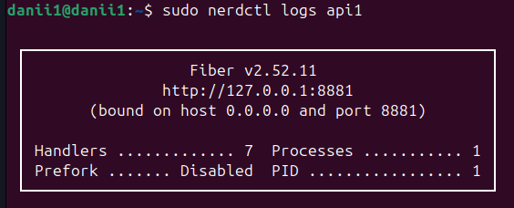

### 7.2 Configuracion de VM2 para API3
Conectarse a VM2 por SSH.
```bash
ssh danni2@192.168.122.79
```

Desplegar API3 utilizando Containerd y Nerdctl, especificando el registro Zot para obtener la imagen.
```bash
# Iniciar API3 en VM2
sudo nerdctl pull --insecure-registry 192.168.122.109:5000/api3-202202768:v1

sudo nerdctl run -d \
  --name api3 \
  --network host \
  -e PORT=":8883" \
  -e API1_URL="http://192.168.122.90:8881" \
  -e API2_URL="http://192.168.122.90:8882" \
  192.168.122.109:5000/api3-202202768:v1
```
Verificar que el contenedor de API3 esté corriendo correctamente en VM2.
```bash
# Listar contenedores en VM2
sudo nerdctl ps
# Deberia ver logs de api3
sudo nerdctl logs api3
```

## 8. Verificar que las APIs se comunican correctamente entre sí

### 8.1 Verificacion de health de las APIs 
Desde el Host, intentar acceder a las APIs utilizando curl.
```bash
# Verificar API1
curl http://192.168.122.90:8881

# Verificar API2
curl http://192.168.122.90:8882

# Verificar API3
curl http://192.168.122.79:8883
```
Deberia mostrar un mensaje como:
```bash
{"VM":"VM1","carnet":"202202768","message":"API1 is Ready","status":"UP","timestamp":"2026-02-17T19:00:00Z"}

{"VM":"VM1","carnet":"202202768","message":"API2 is Ready","status":"UP","timestamp":"2026-02-17T19:41:28Z"}

{"VM":"VM2","carnet":"202202768","message":"API3 is Ready","status":"UP","timestamp":"2026-02-17T19:42:15Z"}
```

### 8.2 Verificacion de comunicacion entre APIs
Desde el Host, intentar acceder a las APIs utilizando curl para verificar que se pueden comunicar entre sí correctamente.
```bash
# Verificar comunicacion entre API1 y API2
curl http://192.168.122.90:8881/api1/202202768/call-api2

# Verificar comunicacion entre API1 y API3
curl http://192.168.122.90:8881/api1/202202768/call-api3

# Verificar comunicacion entre API2 y API1
curl http://192.168.122.90:8882/api2/202202768/call-api1

# Verificar comunicacion entre API2 y API3
curl http://192.168.122.90:8882/api2/202202768/call-api3

# Verificar comunicacion entre API3 y API1
curl http://192.168.122.79:8883/api3/202202768/call-api1

# Verificar comunicacion entre API3 y API2
curl http://192.168.122.79:8883/api3/202202768/call-api2
```

Deberia devolver un mensaje como:
```bash
{"apiname":"API2","carnet":"202202768","connection":true,"message":"The API2 located on the VM1 is working"}

{"apiname":"API3","carnet":"202202768","connection":true,"message":"The API3 located on the VM1 is working"}

{"apiname":"API1","carnet":"202202768","connection":true,"message":"The API1 located on the VM1 is working"}

{"apiname":"API3","carnet":"202202768","connection":true,"message":"The API3 located on the VM1 is working"}

{"apiname":"API1","carnet":"202202768","connection":true,"message":"The API1 located on the VM2 is working"}

{"apiname":"API2","carnet":"202202768","connection":true,"message":"The API2 located on the VM2 is working"}
```
Esto indica que las APIs se están comunicando correctamente entre sí a través de las VMs utilizando Containerd y el registro privado Zot.

---

Eso es todo para la guia de instalación, si se han seguido todos los pasos correctamente, el proyecto debería estar funcionando con las tres APIs desplegadas en las VMs utilizando Containerd y Docker, y el registro privado Zot alojando las imágenes de los contenedores.

Gracias por revisar esta guía de instalación detallada, espero que sea de ayuda para configurar el entorno y desplegar el proyecto correctamente. Si tienes alguna pregunta o necesitas asistencia adicional, no dudes en preguntar.