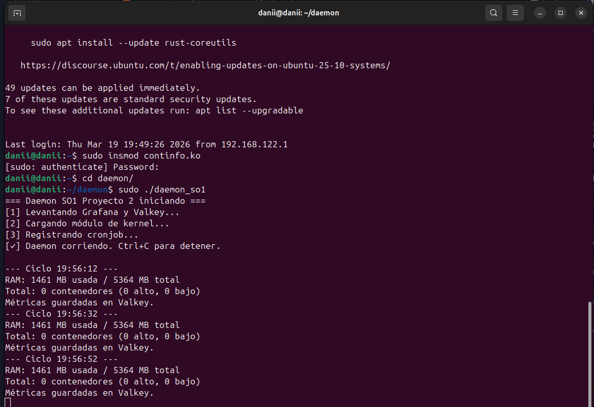
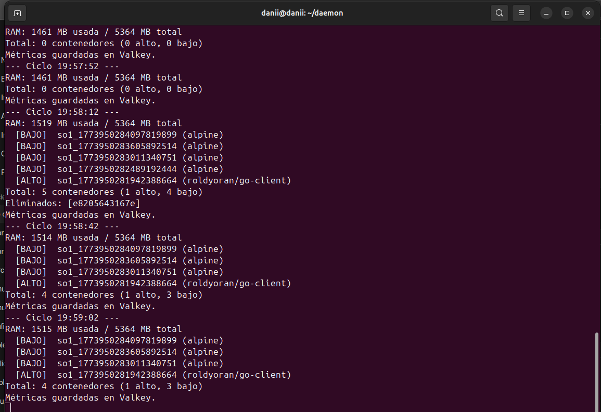
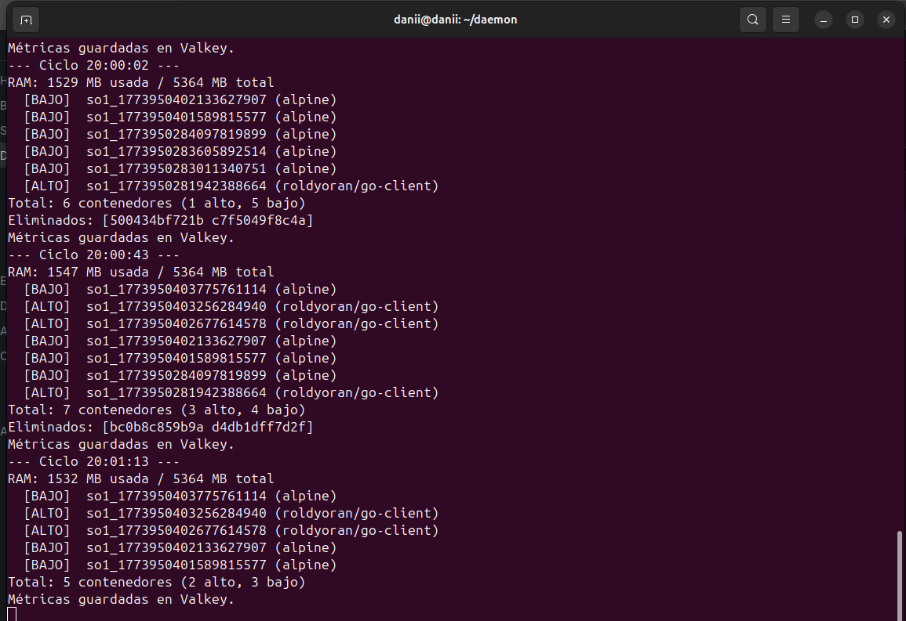
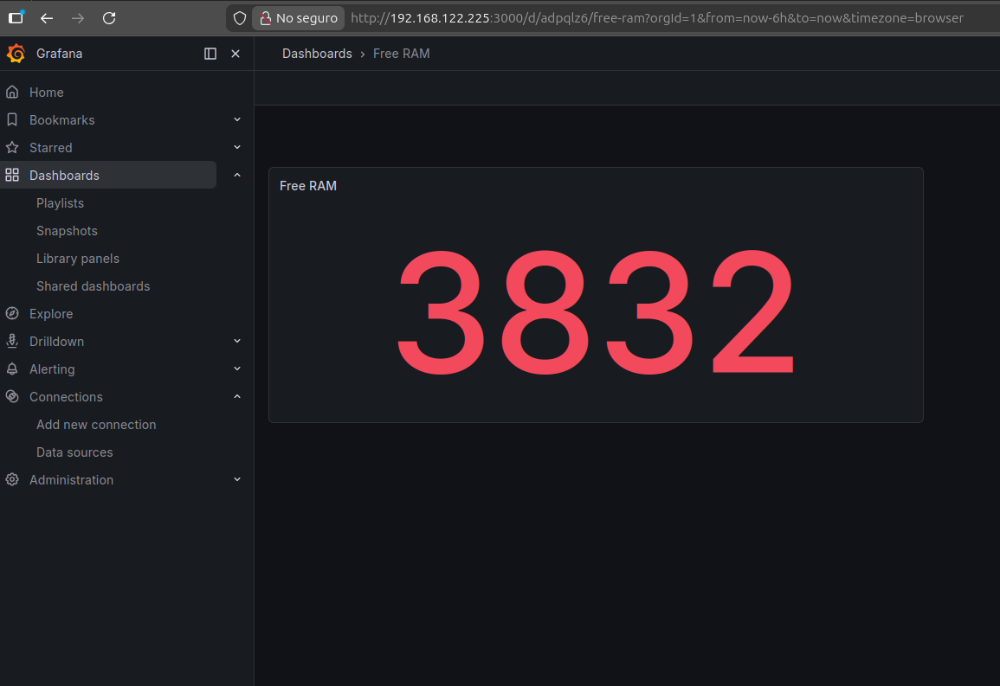
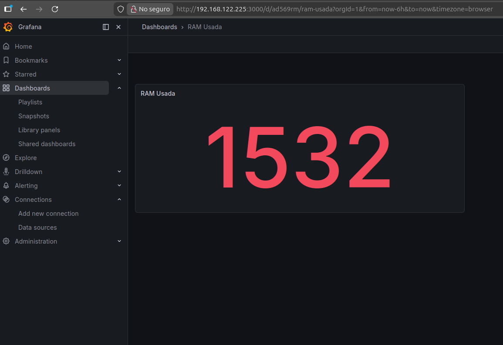
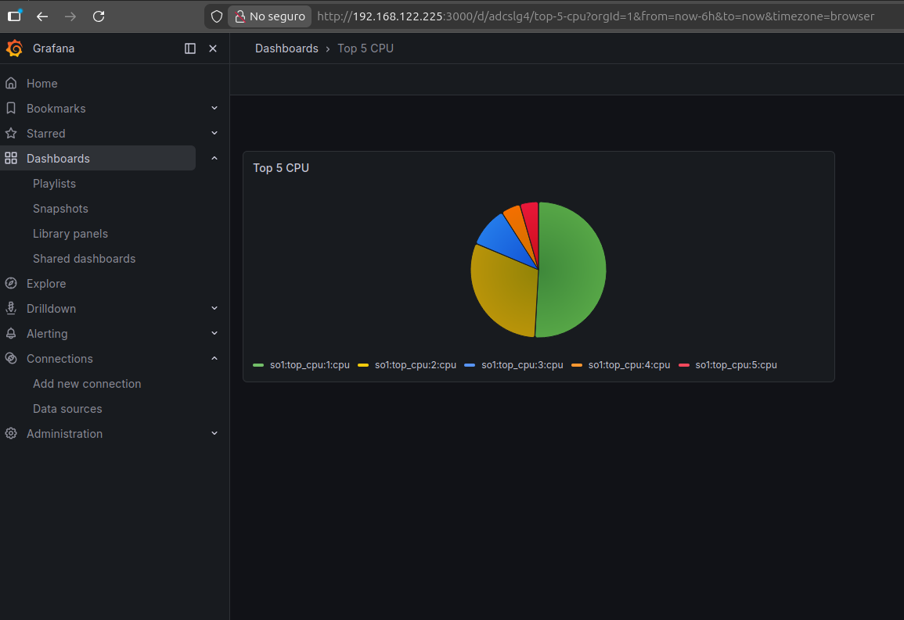
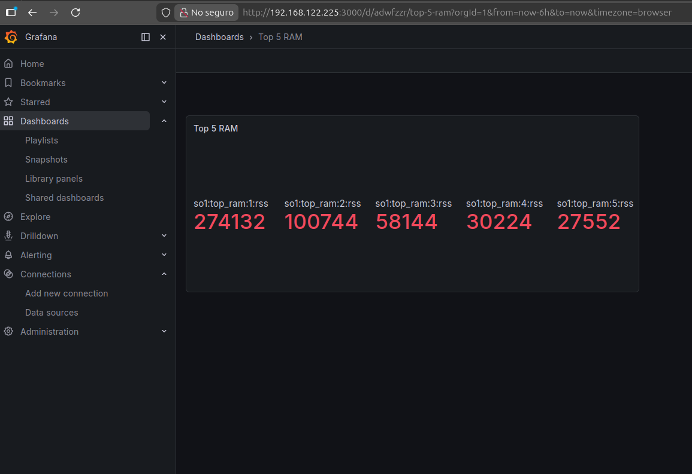
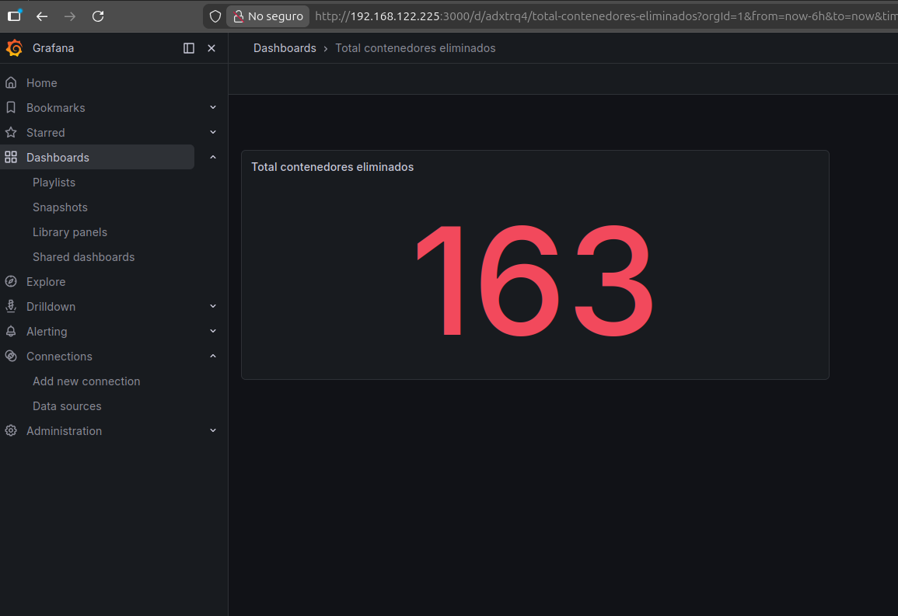
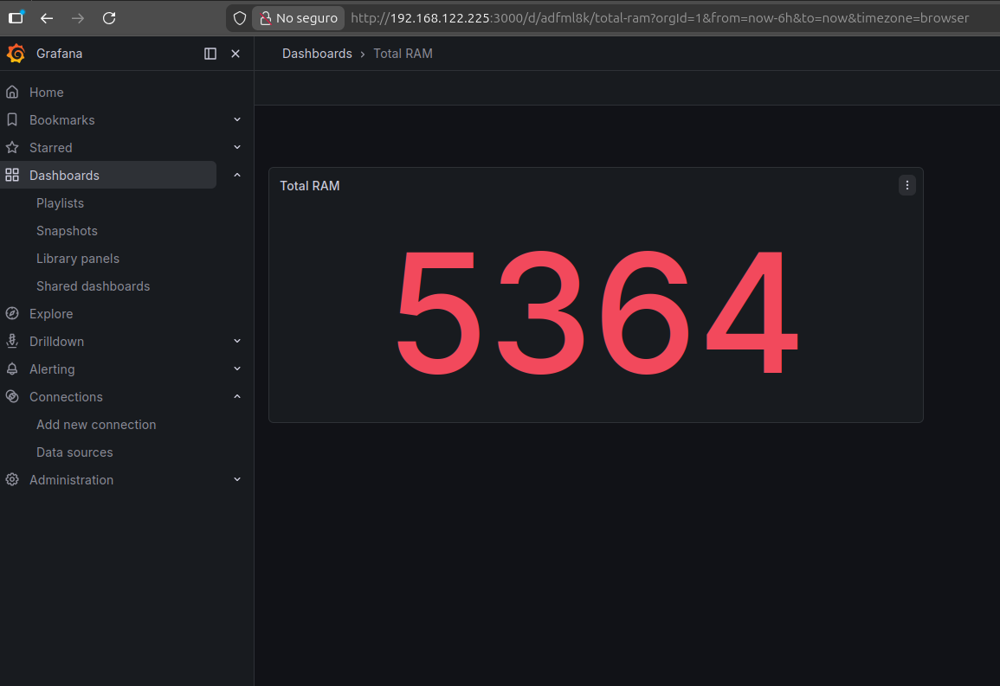
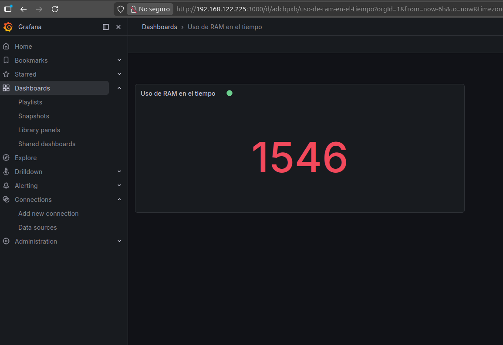

# Manual Técnico — Proyecto 2
## Sonda de Kernel en C y Daemon en Go para la Telemetría de Contenedores
**Sistemas Operativos 1 — Universidad San Carlos de Guatemala**  
**Facultad de Ingeniería — Ingeniería en Ciencias y Sistemas**  
**Nombre: Daniel Estuardo Salvatierra Macajola**  
**Carnet: 202202768**
---

## Índice

1. [Descripción General](#1-descripción-general)
2. [Requisitos del Sistema](#2-requisitos-del-sistema)
3. [Arquitectura del Sistema](#3-arquitectura-del-sistema)
4. [Estructura de Archivos](#4-estructura-de-archivos)
5. [Módulo de Kernel (C)](#5-módulo-de-kernel-c)
6. [Scripts de Automatización](#6-scripts-de-automatización)
7. [Docker Compose — Grafana y Valkey](#7-docker-compose--grafana-y-valkey)
8. [Daemon en Go](#8-daemon-en-go)
9. [Dashboard en Grafana](#9-dashboard-en-grafana)
10. [Guía de Instalación](#10-guía-de-instalación)
11. [Guía de Ejecución](#11-guía-de-ejecución)
12. [Flujo de Funcionamiento](#12-flujo-de-funcionamiento)
13. [Decisiones Técnicas](#13-decisiones-técnicas)
14. [Solución de Problemas](#14-solución-de-problemas)
15. [Imagenes](#15-imagenes-de-funcionamiento)
---

## 1. Descripción General

Este proyecto implementa un sistema integral de monitorización y gestión autónoma de contenedores Docker en entornos Linux. El sistema está compuesto por cuatro componentes principales que trabajan en conjunto:

- **Módulo de Kernel en C**: Actúa como sensor de bajo nivel, accediendo directamente a las estructuras internas del kernel (`task_struct`) para capturar métricas detalladas de procesos y memoria del sistema, exponiéndolas a través del sistema de archivos `/proc`.

- **Daemon en Go**: Cerebro del sistema. Lee los datos del módulo de kernel, clasifica los contenedores por tipo de consumo, aplica una política de gestión automática (mantener 2 contenedores de alto consumo y 3 de bajo consumo), y persiste las métricas en Valkey para su visualización.

- **Cronjob**: Genera carga de trabajo simulada ejecutando un script que crea 5 contenedores Docker aleatorios cada 2 minutos.

- **Dashboard en Grafana**: Visualiza en tiempo real las métricas recolectadas: uso de RAM, contenedores eliminados, y top 5 por consumo de RAM y CPU.

---

## 2. Requisitos del Sistema

### Hardware mínimo
- CPU: 2 núcleos
- RAM: 4 GB (recomendado 6 GB)
- Almacenamiento: 25 GB mínimo

### Software
| Componente | Versión recomendada |
|---|---|
| Sistema Operativo | Ubuntu Server 22.04 LTS |
| Kernel Linux | 5.15+ |
| Go | 1.21+ |
| Docker | 24.0+ |
| Docker Compose | 2.0+ |
| linux-headers | Misma versión que el kernel activo |
| build-essential | Última disponible |

### Instalación de dependencias
```bash
# Actualizar repositorios
sudo apt update && sudo apt upgrade -y

# Dependencias para compilar módulo de kernel
sudo apt install -y linux-headers-$(uname -r) build-essential

# Docker
sudo apt install -y docker.io
sudo systemctl enable docker
sudo systemctl start docker

# Go (descargar desde https://go.dev/dl/)
tar -C /usr/local -xzf go1.21.x.linux-amd64.tar.gz
echo 'export PATH=$PATH:/usr/local/go/bin' >> ~/.bashrc
source ~/.bashrc
```

---

## 3. Arquitectura del Sistema

```
┌─────────────────────────────────────────────────────────┐
│                    DAEMON GO (cerebro)                  │
│  1. Levanta Grafana + Valkey (docker compose)           │
│  2. Registra cronjob                                    │
│  3. Carga módulo de kernel                              │
│  4. Loop cada 20s: lee /proc → analiza → decide → guarda│
└────────┬────────────────────────┬───────────────────────┘
         │                        │
         ▼                        ▼
┌─────────────────┐    ┌──────────────────────┐
│ MÓDULO KERNEL   │    │ CRONJOB (cada 2 min) │
│ /proc/continfo  │    │ Crea 5 contenedores  │
│ task_struct     │    │ aleatorios           │
│ RAM, CPU, VSZ   │    └──────────────────────┘
│ RSS, MEM%       │
└─────────────────┘
         │
         ▼
┌─────────────────┐    ┌──────────────────────┐
│   VALKEY (DB)   │───▶│      GRAFANA         │
│ so1:ram_total   │    │  Dashboard tiempo    │
│ so1:ram_used    │    │  real, auto-refresh  │
│ so1:top_ram:N   │    │  cada 10s            │
│ so1:top_cpu:N   │    └──────────────────────┘
└─────────────────┘
```

---

## 4. Estructura de Archivos

```
~/
├── continfo.c              # Módulo de kernel en C
├── Makefile                # Compilación del módulo
├── docker-compose.yml      # Grafana + Valkey
├── load_module.sh          # Script de carga del módulo
├── spawn_containers.sh     # Script de creación de contenedores
└── daemon/
    ├── go.mod
    ├── go.sum
    ├── main.go             # Punto de entrada del daemon
    ├── config/
    │   └── config.go       # Constantes y configuración
    ├── kernel/
    │   └── reader.go       # Lectura y parseo de /proc
    ├── container/
    │   └── manager.go      # Gestión de contenedores Docker
    ├── storage/
    │   └── valkey.go       # Persistencia en Valkey
    └── cronjob/
        └── cron.go         # Registro/eliminación del cronjob
```

---

## 5. Módulo de Kernel (C)

### Descripción
El módulo `continfo` se registra en el sistema de archivos `/proc` creando el archivo virtual `/proc/continfo_pr2_so1_202202768`. Al ser leído, ejecuta la función `continfo_show()` que itera todos los procesos del sistema usando `for_each_process(task)` sobre la estructura `task_struct` del kernel.

### Datos expuestos
El archivo `/proc` retorna un JSON con la siguiente estructura:

```json
{
  "total_ram_mb": 5363,
  "free_ram_mb": 2801,
  "used_ram_mb": 2562,
  "processes": [
    {
      "pid": 1234,
      "name": "so1_container",
      "vsz": 102400,
      "rss": 30260,
      "mem_percent": 56,
      "cpu_time": 21241449318
    }
  ]
}
```

### Campos del proceso
| Campo | Descripción | Unidad |
|---|---|---|
| `pid` | ID del proceso | Entero |
| `name` | Nombre del proceso (task->comm) | String (máx 16 chars) |
| `vsz` | Tamaño de memoria virtual | KB |
| `rss` | Memoria física residente | KB |
| `mem_percent` | Porcentaje de memoria × 100 | Entero (dividir entre 100) |
| `cpu_time` | Tiempo acumulado de CPU (utime + stime) | Nanosegundos |

### Compilación y uso
```bash
# Compilar
make

# Cargar
sudo insmod continfo.ko

# Verificar
cat /proc/continfo_pr2_so1_202202768

# Descargar
sudo rmmod continfo
```

### Nota sobre el CPU
El kernel no expone un porcentaje de CPU instantáneo. El campo `cpu_time` representa tiempo acumulado en nanosegundos (`utime + stime`). El daemon usa este valor para ordenar procesos por consumo relativo. El enunciado explícitamente permite valores grandes en CPU por esta razón.

---

## 6. Scripts de Automatización

### `load_module.sh`
Carga el módulo de kernel si no está ya cargado. Es ejecutado por el daemon al iniciar.

```bash
#!/bin/bash
MODULE_NAME="continfo"
if lsmod | grep -q "$MODULE_NAME"; then
    echo "Módulo ya cargado."
    exit 0
fi
insmod /home/danii/continfo.ko
echo "Módulo cargado exitosamente."
```

### `spawn_containers.sh`
Ejecutado por el cronjob cada 2 minutos. Crea 5 contenedores con al menos un representante de cada tipo de consumo:

- **Alto consumo RAM**: `roldyoran/go-client`
- **Alto consumo CPU**: `alpine` con bucle de cálculo `bc`
- **Bajo consumo**: `alpine sleep 240`

Los últimos 2 contenedores son aleatorios entre los tres tipos.

---

## 7. Docker Compose — Grafana y Valkey

El archivo `docker-compose.yml` define dos servicios en la misma red interna:

| Servicio | Imagen | Puerto | Nombre del contenedor |
|---|---|---|---|
| Valkey | valkey/valkey:latest | 6379 | valkey_so1 |
| Grafana | grafana/grafana:latest | 3000 | grafana_so1 |

Grafana se comunica con Valkey usando el nombre de host `valkey_so1` dentro de la red Docker `so1_network`.

**Credenciales de Grafana**: usuario `admin`, contraseña `admin`.

---

## 8. Daemon en Go

### Flujo de ejecución

```
Inicio
  │
  ├─ 1. docker compose up -d     (levanta Grafana + Valkey)
  ├─ 2. bash load_module.sh      (carga módulo de kernel)
  ├─ 3. cronjob.Register()       (registra */2 * * * * spawn_containers.sh)
  │
  └─ Loop infinito (cada 20 segundos):
       ├─ kernel.ReadProcFile()      → lee y parsea /proc
       ├─ container.ListContainers() → lista contenedores (excluye protegidos)
       ├─ container.EnforcePolicy()  → elimina excedentes
       ├─ storage.SaveRAMSnapshot()  → guarda métricas de RAM
       ├─ storage.UpdateTopRAM()     → actualiza top 5 por RSS
       └─ storage.UpdateTopCPU()     → actualiza top 5 por CPU time

Ctrl+C (SIGINT/SIGTERM)
  └─ cronjob.Remove()            (elimina la línea del crontab)
```

### Política de gestión de contenedores
El daemon mantiene exactamente:
- **2 contenedores de alto consumo** (go-client o alpine con bc)
- **3 contenedores de bajo consumo** (alpine sleep)

Cuando hay excedentes, elimina los de mayor consumo de recursos primero (ordenados por RSS descendente). Los contenedores `grafana_so1` y `valkey_so1` están en lista de protegidos y nunca se eliminan.

### Clasificación de contenedores
| Imagen | Tipo | Criterio |
|---|---|---|
| `roldyoran/go-client` | Alto | Contiene "go-client" en imagen |
| `alpine` + comando `bc` | Alto | Imagen alpine con "bc" en comando |
| `alpine` + `sleep` | Bajo | Imagen alpine sin bc |

### Datos guardados en Valkey
| Clave | Tipo | Descripción |
|---|---|---|
| `so1:ram_total` | String | RAM total en MB |
| `so1:ram_free` | String | RAM libre en MB |
| `so1:ram_used` | String | RAM usada en MB |
| `so1:ram_ts` | Sorted Set | Historial de RAM usada (score = timestamp) |
| `so1:eliminated` | List | Log de contenedores eliminados |
| `so1:top_ram:N:rss` | String | RSS del contenedor N en top RAM |
| `so1:top_ram:N:name` | String | Nombre del proceso N en top RAM |
| `so1:top_cpu:N:cpu` | String | CPU time del proceso N en top CPU |
| `so1:top_cpu:N:name` | String | Nombre del proceso N en top CPU |

### Compilación y ejecución
```bash
cd ~/daemon

# Instalar dependencias
go mod tidy

# Compilar
go build -o daemon_so1 .

# Ejecutar (requiere sudo para Docker y /proc)
sudo ./daemon_so1
```

---

## 9. Dashboard en Grafana

### Acceso
- URL: `http://localhost:3000`
- Usuario: `admin`
- Contraseña: `admin`

### Plugin requerido
```bash
docker exec -it grafana_so1 grafana-cli plugins install redis-datasource
docker restart grafana_so1
```

### Data Source
- **Nombre**: Valkey-SO1
- **Tipo**: Redis
- **Address**: `valkey_so1:6379`

### Paneles del dashboard
| Panel | Tipo | Query |
|---|---|---|
| Total RAM | Stat | GET so1:ram_total |
| RAM Libre | Stat | GET so1:ram_free |
| RAM Usada | Stat + Streaming | GET so1:ram_used |
| Uso de RAM en el tiempo | Stat (Area) | GET so1:ram_used (Streaming ON) |
| Total eliminados | Stat | LLEN so1:eliminated |
| Top 5 RAM | Stat (5 queries) | GET so1:top_ram:1:rss … so1:top_ram:5:rss |
| Top 5 CPU | Pie Chart (5 queries) | GET so1:top_cpu:1:cpu … so1:top_cpu:5:cpu |

### Auto-refresh
El dashboard está configurado con auto-refresh cada **10 segundos** para mostrar datos en tiempo real sin necesidad de recargar manualmente.

---

## 10. Guía de Instalación

### Paso 1 — Clonar el repositorio
```bash
git clone https://github.com/DanielEstuardo48/202202768_LAB_SO1_1S2026.git
cd 202202768_LAB_SO1_1S2026/proyecto2
```

### Paso 2 — Compilar el módulo de kernel
```bash
sudo apt install -y linux-headers-$(uname -r) build-essential
make
```

### Paso 3 — Dar permisos a los scripts
```bash
chmod +x load_module.sh spawn_containers.sh
```

### Paso 4 — Instalar dependencias de Go
```bash
cd daemon
go mod tidy
go build -o daemon_so1 .
```

### Paso 5 — Instalar plugin de Grafana
```bash
# Primero levantar los servicios
cd ..
docker compose up -d

# Instalar plugin
docker exec -it grafana_so1 grafana-cli plugins install redis-datasource
docker restart grafana_so1
```

### Paso 6 — Configurar Grafana
1. Ir a `http://localhost:3000` (admin/admin)
2. Connections → Data Sources → Add → Redis
3. Address: `valkey_so1:6379`, Name: `Valkey-SO1`
4. Save & Test
5. Crear el dashboard con los 7 paneles descritos en la sección 9

---

## 11. Guía de Ejecución

### Ejecución normal
```bash
# Desde el directorio home
sudo insmod continfo.ko          # Solo si no está cargado
cd daemon
sudo ./daemon_so1                # El daemon se encarga del resto
```

### Verificar que todo funciona
```bash
# Verificar módulo cargado
lsmod | grep continfo

# Verificar datos en /proc
cat /proc/continfo_pr2_so1_202202768

# Verificar contenedores activos
docker ps --format "table {{.Names}}\t{{.Image}}\t{{.Status}}"

# Verificar datos en Valkey
docker exec -it valkey_so1 valkey-cli GET so1:ram_total

# Verificar cronjob registrado
sudo crontab -l
```

### Detener el sistema
```bash
# Ctrl+C en la terminal del daemon (elimina el cronjob automáticamente)

# Descargar módulo de kernel
sudo rmmod continfo

# Detener Grafana y Valkey
docker compose down
```

### Limpiar contenedores de prueba
```bash
docker rm -f $(docker ps -a --filter "name=so1_" -q)
```

---

## 12. Flujo de Funcionamiento

### Ciclo completo del sistema

```
t=0:00  Daemon inicia
        └── Levanta Grafana + Valkey
        └── Carga módulo de kernel
        └── Registra cronjob

t=0:20  Primer ciclo del daemon
        └── Lee /proc → 0 contenedores so1_*
        └── Guarda métricas de RAM en Valkey

t=2:00  Cronjob ejecuta spawn_containers.sh
        └── Crea 5 contenedores nuevos (mezcla alto/bajo)

t=2:20  Segundo ciclo del daemon
        └── Lee /proc → detecta 5 contenedores
        └── Clasifica: ej. 3 alto, 2 bajo
        └── Política: necesita 2 alto + 3 bajo
        └── Elimina 1 alto, crea contexto de bajo (ya existen)
        └── Guarda métricas en Valkey

t=4:00  Cronjob crea 5 más → ahora hay ~10
t=4:20  Daemon detecta 10, elimina exceso → vuelve a 5

... se repite indefinidamente
```

### Comportamiento esperado en consola
```
=== Daemon SO1 Proyecto 2 iniciando ===
[1] Levantando Grafana y Valkey...
[2] Cargando módulo de kernel...
[3] Registrando cronjob...
[✓] Daemon corriendo. Ctrl+C para detener.

--- Ciclo 10:30:00 ---
RAM: 2562 MB usada / 5363 MB total
  [ALTO]  so1_1773894001 (roldyoran/go-client)
  [ALTO]  so1_1773894002 (alpine)
  [BAJO]  so1_1773894003 (alpine)
  [BAJO]  so1_1773894004 (alpine)
  [BAJO]  so1_1773894005 (alpine)
Total: 5 contenedores (2 alto, 3 bajo)
Métricas guardadas en Valkey.
```

---

## 13. Decisiones Técnicas

### ¿Por qué `for_each_process` con `rcu_read_lock`?
La lista de procesos del kernel es una estructura compartida que puede ser modificada por otros hilos del kernel simultáneamente. El mecanismo RCU (Read-Copy-Update) garantiza que la iteración sea segura sin necesitar un lock costoso. El par `rcu_read_lock()` / `rcu_read_unlock()` es la forma correcta de acceder a `task_struct`.

### ¿Por qué `get_task_mm()` en lugar de acceder `task->mm` directamente?
`get_task_mm()` incrementa el contador de referencias del `mm_struct` del proceso. Esto evita que la estructura sea liberada mientras la estamos leyendo. El correspondiente `mmput()` decrementa el contador al terminar. Sin este par, hay riesgo de acceder a memoria liberada (use-after-free en el kernel).

### ¿Por qué Valkey en lugar de una base de datos tradicional?
Valkey (fork de Redis) es un almacén en memoria con operaciones O(1) para GET/SET. Dado que el daemon escribe cada 20 segundos y Grafana lee constantemente, la velocidad de acceso es crítica. Además, el plugin de Redis para Grafana es compatible directamente con Valkey.

### ¿Por qué el daemon no implementa un porcentaje de CPU real?
El kernel expone `utime + stime` como tiempo acumulado, no como porcentaje instantáneo. Para calcular un % real se necesitarían dos lecturas con diferencia de tiempo y dividir el delta entre el intervalo. Dado que el enunciado explícitamente permite valores grandes de CPU, se usa el tiempo acumulado como métrica de ordenamiento relativo, que es suficiente para identificar los procesos de mayor consumo.

### ¿Por qué el cronjob puede crear más de 5 contenedores temporalmente?
Es un diseño intencionado de arquitectura productor/consumidor. El cronjob es un productor simple que no tiene estado; el daemon es el consumidor inteligente que aplica la política. Esto simula un entorno real donde los contenedores pueden aparecer por múltiples fuentes y necesitas un gestor autónomo que mantenga el estado deseado.

---

## 14. Solución de Problemas

### El módulo no compila
```bash
# Verificar que los headers están instalados
ls /lib/modules/$(uname -r)/build

# Si no existe:
sudo apt install linux-headers-$(uname -r)
```

### `/proc/continfo_*` no existe
```bash
# Verificar que el módulo está cargado
lsmod | grep continfo

# Si no aparece, cargarlo
sudo insmod ~/continfo.ko

# Ver errores del kernel
sudo dmesg | tail -20
```

### El daemon no puede conectar a Docker
```bash
# Verificar que Docker está corriendo
sudo systemctl status docker

# Agregar tu usuario al grupo docker (requiere cerrar sesión)
sudo usermod -aG docker $USER
```

### Grafana muestra "No data"
```bash
# Verificar que el daemon corrió al menos un ciclo
docker exec -it valkey_so1 valkey-cli GET so1:ram_total

# Si retorna (nil), el daemon no ha guardado datos aún
# Ejecutar el daemon y esperar 20 segundos

# Verificar que el plugin de Redis está instalado
docker exec -it grafana_so1 grafana-cli plugins ls | grep redis
```

### El cronjob no se registra automáticamente
```bash
# Verificar manualmente
sudo crontab -l

# Si no aparece la línea, registrar manualmente
sudo crontab -e
# Agregar: */2 * * * * /home/danii/spawn_containers.sh >> /var/log/so1_containers.log 2>&1
```

### Valkey no es accesible desde Go
```bash
# Verificar que el contenedor está corriendo
docker ps | grep valkey

# Verificar conectividad
docker exec -it valkey_so1 valkey-cli PING
# Debe responder: PONG
```

---

## 15. Imagenes de Funcionamiento
  
  
  
  

  
  
  



*Manual Técnico — Proyecto 2 — Sistemas Operativos 1 — 1S 2026*