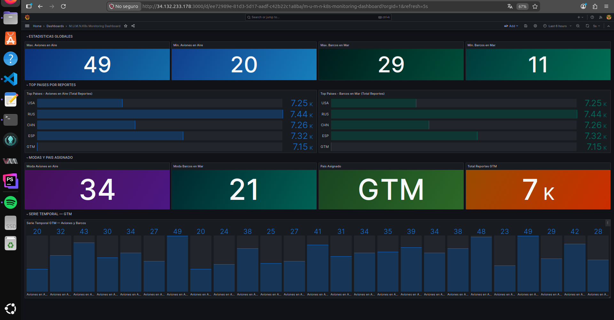
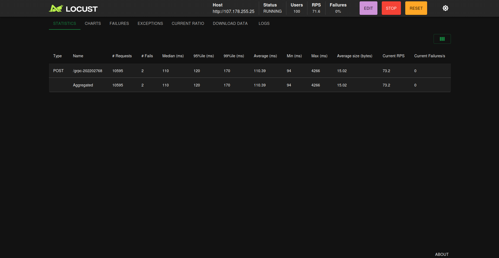
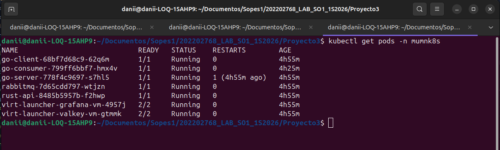
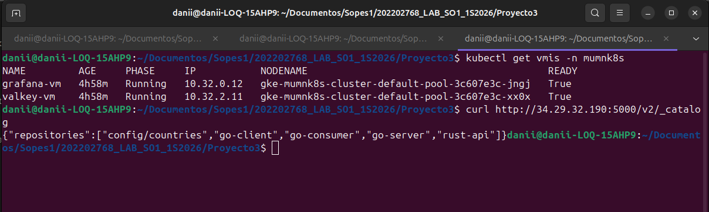

<div align="center">

**Universidad de San Carlos de Guatemala**  
**Facultad de Ingenieria**  
**Sistemas Operativos 1**  
**Nombre: Daniel Estuardo Salvatierra Macajola**   
**Carnet: 202202768**  
**Guatemala 01 de Abril 2026**  

</div>

<h1 align="center">Proyecto 3 - Manual Técnico</h1>

## Tabla de Contenidos

1. [Arquitectura General](#1-arquitectura-general)
2. [Flujo Completo de Datos](#2-flujo-completo-de-datos)
3. [Infraestructura en GCP](#3-infraestructura-en-gcp)
4. [Configuración de Gateway API](#4-configuración-de-gateway-api)
5. [Comunicación REST y gRPC](#5-comunicación-rest-y-grpc)
6. [Uso de RabbitMQ](#6-uso-de-rabbitmq)
7. [Despliegue de Valkey y Grafana con KubeVirt](#7-despliegue-de-valkey-y-grafana-con-kubevirt)
8. [Configuración de HPA](#8-configuración-de-hpa)
9. [Publicación y Consumo de Imágenes desde Zot](#9-publicación-y-consumo-de-imágenes-desde-zot)
10. [OCI Artifact](#10-oci-artifact)
11. [Pruebas de Carga y Análisis de Réplicas](#11-pruebas-de-carga-y-análisis-de-réplicas)
12. [Conclusiones](#12-conclusiones)

---

## 1. Arquitectura General

El sistema M.U.M.N.K8s es una arquitectura distribuida y escalable desplegada en Google Cloud Platform (GCP) utilizando Google Kubernetes Engine (GKE). Simula un centro de monitoreo militar que recibe, procesa, almacena y visualiza reportes de unidades estratégicas de diferentes países en tiempo real.

### Componentes principales

| Componente | Tecnología | Descripción |
|------------|-----------|-------------|
| Generador de tráfico | Locust | Simula usuarios enviando reportes militares |
| Gateway de entrada | Kubernetes Gateway API | Expone el sistema al exterior |
| API REST | Rust (Actix-Web) | Recibe reportes y los reenvía al servicio Go |
| gRPC Client | Go | Recibe de Rust y llama al servidor gRPC |
| gRPC Server | Go | Recibe llamadas gRPC y publica en RabbitMQ |
| Message Broker | RabbitMQ | Cola de mensajes principal |
| Consumer | Go | Consume mensajes y almacena en Valkey |
| Base de datos | Valkey/Redis en KubeVirt VM | Almacenamiento de datos procesados |
| Visualización | Grafana en KubeVirt VM | Dashboard de métricas en tiempo real |
| Container Registry | Zot | Registro de imágenes Docker externo al clúster |

### Diagrama de arquitectura

```
                    ┌─────────────────────────────────────────────────┐
                    │              Google Cloud Platform               │
                    │                                                  │
  ┌─────────┐       │  ┌──────────┐    ┌──────────────────────────┐  │
  │  Locust │──────▶│  │ Gateway  │───▶│     GKE Cluster          │  │
  └─────────┘       │  │   API    │    │                          │  │
                    │  └──────────┘    │  ┌─────────┐             │  │
                    │                  │  │Rust API │             │  │
  ┌──────────┐      │                  │  │  (HPA)  │             │  │
  │   Zot    │◀────▶│                  │  └────┬────┘             │  │
  │ Registry │      │                  │       │                  │  │
  └──────────┘      │                  │  ┌────▼────┐             │  │
   VM en GCP        │                  │  │Go Client│             │  │
                    │                  │  │ gRPC    │             │  │
                    │                  │  └────┬────┘             │  │
                    │                  │       │ gRPC             │  │
                    │                  │  ┌────▼────┐             │  │
                    │                  │  │Go Server│             │  │
                    │                  │  │RabbitMQ │             │  │
                    │                  │  │ Writer  │             │  │
                    │                  │  └────┬────┘             │  │
                    │                  │       │                  │  │
                    │                  │  ┌────▼────┐             │  │
                    │                  │  │RabbitMQ │             │  │
                    │                  │  └────┬────┘             │  │
                    │                  │       │                  │  │
                    │                  │  ┌────▼────┐             │  │
                    │                  │  │Go       │             │  │
                    │                  │  │Consumer │             │  │
                    │                  │  └────┬────┘             │  │
                    │                  │       │                  │  │
                    │                  │  ┌────▼──────────────┐  │  │
                    │                  │  │   KubeVirt VMs    │  │  │
                    │                  │  │  ┌─────┐ ┌──────┐ │  │  │
                    │                  │  │  │Valkey│ │Grafana│ │  │  │
                    │                  │  │  └─────┘ └──────┘ │  │  │
                    │                  │  └───────────────────┘  │  │
                    │                  └──────────────────────────┘  │
                    └─────────────────────────────────────────────────┘
```

---

## 2. Flujo Completo de Datos

El flujo de datos sigue este camino desde la generación hasta la visualización:

### Paso 1 — Generación de tráfico (Locust)

Locust genera reportes militares simulados con datos aleatorios:

```json
{
  "country": "GTM",
  "warplanes_in_air": 25,
  "warships_in_water": 12,
  "timestamp": "2026-05-01T00:00:00Z"
}
```

Los países válidos son: `USA`, `RUS`, `CHN`, `ESP`, `GTM`. Los valores de aviones van de 0 a 50 y los barcos de 0 a 30.

### Paso 2 — Gateway API

El tráfico entra por el Kubernetes Gateway API en la IP `107.178.255.25` por la ruta `/grpc-202202768` y se redirige al servicio `rust-api` en el puerto 8080.

### Paso 3 — API REST en Rust

La API recibe el JSON, lo valida y lo reenvía al servicio Go Client via HTTP:

```
POST /grpc-202202768 → rust-api:8080 → go-client:8081/report
```

### Paso 4 — Go gRPC Client

El Go Client recibe el reporte, convierte el string del país al enum del proto y realiza una llamada gRPC al servidor:

```protobuf
rpc SendReport (WarReportRequest) returns (WarReportResponse);
```

### Paso 5 — Go gRPC Server

El servidor gRPC recibe la solicitud y publica el mensaje en la cola `war_reports` de RabbitMQ en formato JSON.

### Paso 6 — RabbitMQ Consumer

El Consumer lee los mensajes de la cola `war_reports`, los procesa y calcula estadísticas en tiempo real (max, min, moda) que guarda en Valkey.

### Paso 7 — Valkey (Redis)

Los datos se almacenan con estas estructuras de keys:

| Key | Descripción |
|-----|-------------|
| `reports:count:{PAIS}` | Contador total de reportes por país |
| `reports:last:{PAIS}` | Último reporte recibido del país |
| `timeline:planes:{PAIS}` | Lista de últimos 100 valores de aviones |
| `timeline:ships:{PAIS}` | Lista de últimos 100 valores de barcos |
| `stat:planes:max` | Valor máximo global de aviones |
| `stat:planes:min` | Valor mínimo global de aviones |
| `stat:planes:moda` | Moda global de aviones |
| `stat:ships:max` | Valor máximo global de barcos |
| `stat:ships:min` | Valor mínimo global de barcos |
| `stat:ships:moda` | Moda global de barcos |
| `top:warplanes` | Sorted set con acumulado de aviones por país |
| `top:warships` | Sorted set con acumulado de barcos por país |
| `assigned:country` | País asignado (GTM para carnet 202202768) |

### Paso 8 — Grafana

Grafana se conecta a Valkey mediante el plugin `redis-datasource` y visualiza los datos en tiempo real con refresh de 5 segundos.

---

## 3. Infraestructura en GCP

### Clúster GKE

```bash
gcloud container clusters create mumnk8s-cluster \
  --project=mumnk8s-proyecto \
  --zone=us-central1-a \
  --machine-type=n1-standard-4 \
  --num-nodes=3 \
  --image-type=UBUNTU_CONTAINERD \
  --enable-nested-virtualization
```

- **Zona:** us-central1-a
- **Tipo de instancia:** N1 Standard 4 (4 vCPUs, 15GB RAM)
- **Nodos:** 3
- **Virtualización anidada:** Habilitada (requerida para KubeVirt)

### VM para Zot Registry

```bash
gcloud compute instances create zot-registry \
  --project=mumnk8s-proyecto \
  --zone=us-central1-a \
  --machine-type=n1-standard-2 \
  --image-family=ubuntu-2204-lts \
  --image-project=ubuntu-os-cloud \
  --boot-disk-size=30GB
```

- **IP externa:** 34.29.32.190
- **Puerto:** 5000
- **Servicio:** Zot como systemd service

### Namespaces de Kubernetes

```yaml
apiVersion: v1
kind: Namespace
metadata:
  name: mumnk8s
```

---

## 4. Configuración de Gateway API

Se utiliza el **Kubernetes Gateway API** de GKE en lugar del Ingress Controller tradicional, siguiendo las especificaciones del proyecto.

### GatewayClass

```yaml
apiVersion: gateway.networking.k8s.io/v1
kind: GatewayClass
metadata:
  name: gke-l7-global-external-managed
spec:
  controllerName: networking.gke.io/gateway
```

### Gateway

```yaml
apiVersion: gateway.networking.k8s.io/v1
kind: Gateway
metadata:
  name: mumnk8s-gateway
  namespace: mumnk8s
spec:
  gatewayClassName: gke-l7-global-external-managed
  listeners:
  - name: http
    port: 80
    protocol: HTTP
    allowedRoutes:
      namespaces:
        from: Same
```

### HTTPRoute

```yaml
apiVersion: gateway.networking.k8s.io/v1
kind: HTTPRoute
metadata:
  name: mumnk8s-route
  namespace: mumnk8s
spec:
  parentRefs:
  - name: mumnk8s-gateway
  rules:
  - matches:
    - path:
        type: PathPrefix
        value: /grpc-202202768
    backendRefs:
    - name: rust-api
      port: 8080
  - matches:
    - path:
        type: PathPrefix
        value: /health
    backendRefs:
    - name: rust-api
      port: 8080
```

### IP del Gateway

- **IP pública:** `107.178.255.25`
- **Endpoint principal:** `http://107.178.255.25/grpc-202202768`

### Habilitación en GKE

```bash
gcloud container clusters update mumnk8s-cluster \
  --gateway-api=standard \
  --zone=us-central1-a \
  --project=mumnk8s-proyecto
```

---

## 5. Comunicación REST y gRPC

### API REST en Rust

La API está desarrollada con **Actix-Web** y expone los siguientes endpoints:

| Método | Ruta | Descripción |
|--------|------|-------------|
| GET | `/` | Health check para el load balancer de GCP |
| GET | `/health` | Health check del servicio |
| POST | `/grpc-202202768` | Recibe reportes militares de Locust |

#### Estructura del handler principal

```rust
async fn receive_report(
    report: web::Json<WarReport>,
    client: web::Data<reqwest::Client>,
) -> HttpResponse {
    let go_url = "http://go-client:8081/report";
    let result = client.post(go_url).json(&report.into_inner()).send().await;
    match result {
        Ok(_) => HttpResponse::Ok().json(serde_json::json!({"status": "ok"})),
        Err(e) => HttpResponse::InternalServerError().json(...)
    }
}
```

### Definición Proto

```protobuf
syntax = "proto3";
package warreport;

enum Country {
  UNKNOWN = 0;
  USA = 1;
  RUS = 2;
  CHN = 3;
  ESP = 4;
  GTM = 5;
}

message WarReportRequest {
  Country country = 1;
  int32 warplanes_in_air = 2;
  int32 warships_in_water = 3;
  string timestamp = 4;
}

message WarReportResponse {
  string status = 1;
}

service WarReportService {
  rpc SendReport (WarReportRequest) returns (WarReportResponse);
}
```

### Go gRPC Client (Deployment 1)

Recibe el JSON de Rust via HTTP en el puerto `8081`, convierte el país a enum y llama al servidor gRPC:

```go
resp, err := grpcClient.SendReport(ctx, &pb.WarReportRequest{
    Country:         countryEnum,
    WarplanesInAir:  report.WarplanesInAir,
    WarshipsInWater: report.WarshipsInWater,
    Timestamp:       report.Timestamp,
})
```

### Go gRPC Server (Deployment 2)

Implementa la interfaz generada por protoc y publica en RabbitMQ:

```go
func (s *server) SendReport(ctx context.Context, req *pb.WarReportRequest) (*pb.WarReportResponse, error) {
    body, _ := json.Marshal(msg)
    err = s.rabbitChannel.Publish("", "war_reports", false, false,
        amqp.Publishing{ContentType: "application/json", Body: body})
    return &pb.WarReportResponse{Status: "ok"}, nil
}
```

---

## 6. Uso de RabbitMQ

RabbitMQ actúa como el broker de mensajería principal del sistema.

### Despliegue en GKE

```yaml
apiVersion: apps/v1
kind: Deployment
metadata:
  name: rabbitmq
  namespace: mumnk8s
spec:
  replicas: 1
  template:
    spec:
      containers:
      - name: rabbitmq
        image: rabbitmq:3-management
        ports:
        - containerPort: 5672   # AMQP
        - containerPort: 15672  # Management UI
```

### Cola principal

- **Nombre:** `war_reports`
- **Tipo:** Durable (sobrevive reinicios)
- **Auto-delete:** false

### Publisher (Go Server)

El Go Server publica mensajes en la cola con el siguiente formato:

```json
{
  "country": "GTM",
  "warplanes_in_air": 25,
  "warships_in_water": 12,
  "timestamp": "2026-05-01T00:00:00Z"
}
```

### Consumer (Go Consumer)

El Consumer procesa los mensajes con goroutines para manejar concurrencia:

```go
for msg := range msgs {
    go func(m amqp.Delivery) {
        var report WarReportMessage
        json.Unmarshal(m.Body, &report)
        saveToValkey(valkeyClient, report)
    }(msg)
}
```

---

## 7. Despliegue de Valkey y Grafana con KubeVirt

### Instalación de KubeVirt

```bash
export KUBEVIRT_VERSION=v1.4.0
kubectl apply -f https://github.com/kubevirt/kubevirt/releases/download/${KUBEVIRT_VERSION}/kubevirt-operator.yaml
kubectl apply -f https://github.com/kubevirt/kubevirt/releases/download/${KUBEVIRT_VERSION}/kubevirt-cr.yaml
```

### Discos Persistentes con CDI

Se utilizó el CDI (Containerized Data Importer) para crear discos persistentes que conservan los datos entre reinicios:

```bash
export CDI_VERSION=$(curl -s https://api.github.com/repos/kubevirt/containerized-data-importer/releases/latest | grep '"tag_name"' | cut -d'"' -f4)
kubectl apply -f https://github.com/kubevirt/containerized-data-importer/releases/download/$CDI_VERSION/cdi-operator.yaml
kubectl apply -f https://github.com/kubevirt/containerized-data-importer/releases/download/$CDI_VERSION/cdi-cr.yaml
```

### VM de Valkey

```yaml
apiVersion: kubevirt.io/v1
kind: VirtualMachine
metadata:
  name: valkey-vm
  namespace: mumnk8s
spec:
  runStrategy: Always
  template:
    metadata:
      labels:
        app: valkey-vm
    spec:
      domain:
        cpu:
          cores: 1
        memory:
          guest: 1Gi
        devices:
          disks:
          - name: rootdisk
            disk:
              bus: virtio
          interfaces:
          - name: default
            bridge: {}
      networks:
      - name: default
        pod: {}
      volumes:
      - name: rootdisk
        persistentVolumeClaim:
          claimName: valkey-disk
```

**Configuración de Redis dentro de la VM:**

```bash
sudo apt-get install -y redis-server
sudo sed -i 's/^bind.*/bind 0.0.0.0/' /etc/redis/redis.conf
sudo systemctl enable redis-server
sudo systemctl start redis-server
```

**Configuración de red persistente:**

```bash
sudo bash -c 'cat > /etc/netplan/99-kubevirt.yaml << EOF
network:
  version: 2
  ethernets:
    enp1s0:
      dhcp4: true
EOF'
sudo netplan apply
```

### VM de Grafana

```yaml
apiVersion: kubevirt.io/v1
kind: VirtualMachine
metadata:
  name: grafana-vm
  namespace: mumnk8s
spec:
  runStrategy: Always
  template:
    metadata:
      labels:
        app: grafana-vm
    spec:
      domain:
        cpu:
          cores: 2
        memory:
          guest: 2Gi
        devices:
          disks:
          - name: rootdisk
            disk:
              bus: virtio
          interfaces:
          - name: default
            masquerade: {}
      volumes:
      - name: rootdisk
        persistentVolumeClaim:
          claimName: grafana-disk
```

**Instalación de Grafana en Fedora:**

```bash
sudo dnf install -y grafana redis
sudo grafana-cli plugins install redis-datasource
sudo setenforce 0
sudo sed -i 's/SELINUX=enforcing/SELINUX=permissive/' /etc/selinux/config
sudo systemctl enable grafana-server
sudo systemctl start grafana-server
```

### Services para las VMs

```yaml
# Service para Valkey
apiVersion: v1
kind: Service
metadata:
  name: valkey
  namespace: mumnk8s
spec:
  selector:
    app: valkey-vm
  ports:
  - port: 6379
    targetPort: 6379
---
# Service para Grafana (LoadBalancer externo)
apiVersion: v1
kind: Service
metadata:
  name: grafana
  namespace: mumnk8s
spec:
  selector:
    app: grafana-vm
  ports:
  - port: 3000
    targetPort: 3000
  type: LoadBalancer
```

### Dashboard de Grafana

El dashboard incluye los siguientes paneles requeridos:

| Panel | Tipo | Query |
|-------|------|-------|
| Max. Aviones en Aire | Stat | `GET stat:planes:max` |
| Min. Aviones en Aire | Stat | `GET stat:planes:min` |
| Max. Barcos en Mar | Stat | `GET stat:ships:max` |
| Min. Barcos en Mar | Stat | `GET stat:ships:min` |
| Moda Aviones en Aire | Stat | `GET stat:planes:moda` |
| Moda Barcos en Mar | Stat | `GET stat:ships:moda` |
| País Asignado | Stat | `GET assigned:country` |
| Total Reportes GTM | Stat | `GET reports:count:GTM` |
| Top Países Aviones | Bar gauge | `GET reports:count:{PAIS}` x5 |
| Top Países Barcos | Bar gauge | `GET reports:count:{PAIS}` x5 |
| Serie Temporal GTM | Bar gauge | `LRANGE timeline:planes:GTM 0 99` |

**País asignado:** GTM (último dígito del carnet 202202768 = 8 → GTM)



---

## 8. Configuración de HPA

El HPA (Horizontal Pod Autoscaler) está configurado para el deployment de Rust API:

```yaml
apiVersion: autoscaling/v2
kind: HorizontalPodAutoscaler
metadata:
  name: rust-api-hpa
  namespace: mumnk8s
spec:
  scaleTargetRef:
    apiVersion: apps/v1
    kind: Deployment
    name: rust-api
  minReplicas: 1
  maxReplicas: 3
  metrics:
  - type: Resource
    resource:
      name: cpu
      target:
        type: Utilization
        averageUtilization: 30
```

### Verificación del HPA

```bash
kubectl get hpa -n mumnk8s
```

Resultado observado durante las pruebas de carga:

```
NAME           REFERENCE             TARGETS      MINPODS   MAXPODS   REPLICAS
rust-api-hpa   Deployment/rust-api   cpu: 8%/30%  1         3         1
```

El HPA mantiene el sistema en 1 réplica porque el CPU se mantiene bajo el umbral del 30% incluso con 100 usuarios concurrentes, lo que indica que la API Rust es eficiente en el uso de recursos.

---

## 9. Publicación y Consumo de Imágenes desde Zot

### Instalación de Zot como servicio systemd

```bash
wget https://github.com/project-zot/zot/releases/download/v2.1.0/zot-linux-amd64 -O zot
chmod +x zot

sudo bash -c 'cat > /etc/systemd/system/zot.service << EOF
[Unit]
Description=Zot Container Registry
After=network.target

[Service]
ExecStart=/home/danii/zot serve /home/danii/config.json
Restart=always
User=root

[Install]
WantedBy=multi-user.target
EOF'

sudo systemctl enable zot
sudo systemctl start zot
```

### Configuración de Zot

```json
{
  "distSpecVersion": "1.1.0",
  "storage": {
    "rootDirectory": "/var/lib/zot"
  },
  "http": {
    "address": "0.0.0.0",
    "port": "5000"
  },
  "log": {
    "level": "info"
  }
}
```

### Publicación de imágenes

```bash
# Configurar Docker para registro inseguro
echo '{"insecure-registries": ["34.29.32.190:5000"]}' | \
  sudo tee /etc/docker/daemon.json
sudo systemctl restart docker

# Construir y publicar cada imagen
docker build -t 34.29.32.190:5000/rust-api:latest ./rust-api
docker push 34.29.32.190:5000/rust-api:latest

docker build -t 34.29.32.190:5000/go-client:latest ./go-client
docker push 34.29.32.190:5000/go-client:latest

docker build -t 34.29.32.190:5000/go-server:latest ./go-server
docker push 34.29.32.190:5000/go-server:latest

docker build -t 34.29.32.190:5000/go-consumer:latest ./go-consumer
docker push 34.29.32.190:5000/go-consumer:latest
```

### Configuración de nodos GKE para consumir desde Zot

En cada nodo del clúster se configura containerd para aceptar el registro HTTP:

```bash
sudo mkdir -p /etc/containerd/certs.d/34.29.32.190:5000
cat > /etc/containerd/certs.d/34.29.32.190:5000/hosts.toml << EOF
server = "http://34.29.32.190:5000"
[host."http://34.29.32.190:5000"]
  capabilities = ["pull", "resolve", "push"]
  skip_verify = true
EOF
sudo systemctl restart containerd
```

### Verificación del catálogo

```bash
curl http://34.29.32.190:5000/v2/_catalog
# {"repositories":["config/countries","go-client","go-consumer","go-server","rust-api"]}
```

---

## 10. OCI Artifact

Se implementó la descarga de un archivo de configuración desde Zot como OCI Artifact usando la herramienta **oras**.

### Publicación del Artifact

```bash
# Instalar oras
curl -LO https://github.com/oras-project/oras/releases/download/v1.1.0/oras_1.1.0_linux_amd64.tar.gz
tar -zxf oras_1.1.0_linux_amd64.tar.gz
sudo mv oras /usr/local/bin/

# Crear archivo de configuración
cat > locust/countries.json << EOF
{
  "countries": ["USA", "RUS", "CHN", "ESP", "GTM"],
  "ranges": {
    "warplanes_in_air": {"min": 0, "max": 50},
    "warships_in_water": {"min": 0, "max": 30}
  },
  "assigned_country": "GTM"
}
EOF

# Publicar como OCI Artifact
oras push 34.29.32.190:5000/config/countries:latest \
  --plain-http \
  locust/countries.json:application/json
```

### Descarga desde el clúster

Se creó un Job de Kubernetes que descarga y usa el artifact:

```yaml
apiVersion: batch/v1
kind: Job
metadata:
  name: download-oci-artifact
  namespace: mumnk8s
spec:
  template:
    spec:
      containers:
      - name: download-artifact
        image: ghcr.io/oras-project/oras:v1.1.0
        command:
        - sh
        - -c
        - |
          cd /tmp &&
          oras pull 34.29.32.190:5000/config/countries:latest --plain-http &&
          cat /tmp/locust/countries.json
      restartPolicy: Never
```

**Resultado de la descarga:**
```json
{
  "countries": ["USA", "RUS", "CHN", "ESP", "GTM"],
  "ranges": {
    "warplanes_in_air": {"min": 0, "max": 50},
    "warships_in_water": {"min": 0, "max": 30}
  },
  "assigned_country": "GTM"
}
```

---

## 11. Pruebas de Carga y Análisis de Réplicas

### Configuración de Locust

```python
from locust import HttpUser, task, between
import random
from datetime import datetime, timezone

COUNTRIES = ["USA", "RUS", "CHN", "ESP", "GTM"]

class MilitaryReportUser(HttpUser):
    wait_time = between(0.5, 2)

    @task
    def send_report(self):
        payload = {
            "country": random.choice(COUNTRIES),
            "warplanes_in_air": random.randint(0, 50),
            "warships_in_water": random.randint(0, 30),
            "timestamp": datetime.now(timezone.utc).isoformat()
        }
        self.client.post("/grpc-202202768", json=payload,
            headers={"Content-Type": "application/json"})
```

### Prueba con 1 réplica de Go Server

**Configuración:** 100 usuarios, spawn rate 10/s, host: `http://107.178.255.25`

| Métrica | Valor |
|---------|-------|
| Total Requests | 10,595 |
| Failures | 2 (0%) |
| RPS actual | 73.2 |
| Tiempo promedio | 110ms |
| Mediana | 110ms |
| Percentil 95 | 120ms |
| Percentil 99 | 170ms |
| Tiempo máximo | 4,266ms |
| Tiempo mínimo | 94ms |



### Prueba con 2 réplicas de Go Server

**Comando para escalar:**
```bash
kubectl scale deployment go-server -n mumnk8s --replicas=2
```

**Configuración:** 100 usuarios, spawn rate 10/s, host: `http://107.178.255.25`

| Métrica | Valor |
|---------|-------|
| Total Requests | 7,242 |
| Failures | 0 (0%) |
| RPS actual | 72.4 |
| Tiempo promedio | 112ms |
| Mediana | 110ms |
| Percentil 95 | 130ms |
| Percentil 99 | 180ms |
| Tiempo máximo | 427ms |
| Tiempo mínimo | 95ms |


### Análisis comparativo

| Métrica | 1 Réplica | 2 Réplicas | Diferencia |
|---------|-----------|------------|------------|
| RPS | 73.2 | 72.4 | -1.1% |
| Tiempo promedio | 110ms | 112ms | +1.8% |
| Percentil 95 | 120ms | 130ms | +8.3% |
| Percentil 99 | 170ms | 180ms | +5.9% |
| **Tiempo máximo** | **4,266ms** | **427ms** | **-90%** |
| Failures | 0% | 0% | Sin cambio |

### Conclusión del análisis

El resultado más significativo es la reducción del tiempo máximo de respuesta en un 90% (de 4,266ms a 427ms) al usar 2 réplicas. Esto indica que con 2 réplicas el sistema es más estable y consistente bajo carga alta, eliminando los picos extremos de latencia.

El RPS y el tiempo promedio son prácticamente iguales porque el cuello de botella del sistema no es el Go Server sino la red y el Gateway API de GKE. Sin embargo, la mejora en la consistencia (eliminación de picos) es fundamental para un sistema de monitoreo en tiempo real.

---

## 12. Conclusiones

### Tecnologías implementadas

- **Kubernetes y GKE:** Orquestación de contenedores en la nube con escalabilidad automática mediante HPA.
- **KubeVirt:** Virtualización dentro de Kubernetes para ejecutar VMs de Valkey y Grafana, demostrando la capacidad de combinar contenedores y VMs en el mismo clúster.
- **gRPC:** Comunicación eficiente entre microservicios Go con serialización binaria via Protocol Buffers.
- **RabbitMQ:** Desacoplamiento del sistema mediante mensajería asíncrona con colas durables.
- **Zot:** Registry de imágenes compatible con OCI como alternativa a Docker Hub, desplegado en infraestructura propia.
- **Gateway API:** Exposición del sistema usando la nueva API de Kubernetes para gestión de tráfico de entrada.

### Aprendizajes

1. La virtualización anidada en GKE con KubeVirt permite ejecutar VMs dentro de pods, lo que habilita escenarios híbridos de contenedores y VMs.
2. El uso de PersistentVolumeClaims con CDI garantiza la persistencia de datos en las VMs de KubeVirt entre reinicios.
3. La comunicación entre VMs de KubeVirt y pods del clúster requiere configuración especial de red (modo bridge vs masquerade).
4. El Gateway API de GKE ofrece más funcionalidades que el Ingress Controller tradicional pero requiere configuración adicional del health check.
5. Las pruebas de carga demuestran que agregar réplicas mejora la consistencia del sistema, especialmente en la reducción de picos de latencia.

---

## 13. Imagenes Extra

### Pods corriendo en GKE   


### VMs de KubeVirt y catalogo de Zot   
